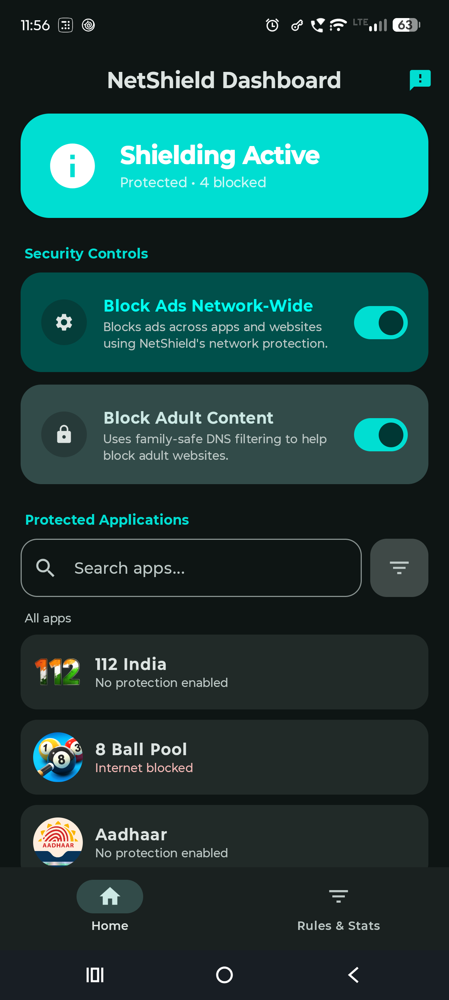
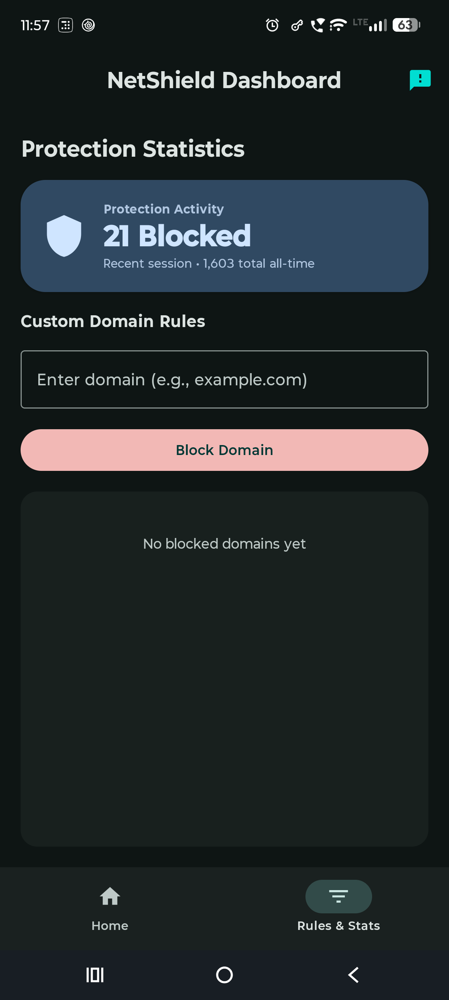

# 🛡️ NetShield — Native Android VPN, Privacy & Firewall Engine

[](LICENSE)
[](https://developer.android.com)
[](https://kotlinlang.org)

**NetShield** is a high-performance, **100% native Kotlin** Android VPN and network protection engine developed by **Fardeen Sayyed**. Operating **100% locally on-device**, NetShield provides network-wide ad/tracker blocking, adult content filtering, network-layer SafeSearch enforcement, real-time push notification fast-paths, and per-app internet firewall controls with ultra-low battery consumption.

---

## 🔒 100% Local & Private Protection
NetShield runs **entirely on your phone**. All DNS packet parsing, $O(k)$ Reverse Trie domain matching, per-app firewall checks, and Room database statistics occur **100% locally on-device**. No network traffic, browsing logs, or personal user data ever leave your phone or get uploaded to any remote server.

---

## 📱 Application Screenshots

| Home Dashboard | Custom Rules & Protection Stats |
| :---: | :---: |
|  |  |

---

## 📥 Installation & Setup Guide

### Step 1: Download & Install the APK
1. Download `NetShield-v1.0.0.apk` from the **[GitHub Releases Page](https://github.com/FardeenSayyed/NetShield/releases)**.
2. Tap the downloaded `.apk` file to install.
3. If Google Play Protect shows a popup (*Unrecognized Developer / Blocked by Play Protect*):
   - Tap the **down arrow ( More details )**.
   - Tap **Install anyway**.

### Step 2: Enable Always-On Protection & Unrestricted Battery
To ensure Android does not automatically turn off NetShield during overnight battery optimization (Doze mode):
1. **Always-On VPN**:
   - Go to **Settings → Network & Internet → VPN**.
   - Tap the **gear icon ⚙️** next to **NetShield**.
   - Turn on **Always-on VPN**.
2. **Unrestricted Battery Saver**:
   - Go to **Settings → Apps → NetShield → Battery**.
   - Select **Unrestricted** (or *Allow background usage*).

---

## ℹ️ Ad Blocking Scope & Transparency Note
- **What NetShield Blocks**: NetShield blocks 100% of **3rd-party ad networks, tracking domains, pop-ups, mobile gaming ad SDKs** (Unity, ironSource, AppLovin, Pangle), **telemetry, adult websites, porn comics, and NSFW AI chat platforms** across all apps and browsers.
- **First-Party Video Stream Ads (YouTube, Instagram, Spotify)**: NetShield does **not** block ads that are stitched directly inside first-party video/audio streams on apps like YouTube, Instagram, or Spotify. Blocking the video stream domains (`googlevideo.com` / `cdninstagram.com`) would break main video playback and cause the apps to fail.

---

## ✨ Key Features

- ⚡ **100% Native Architecture**: Written in pure Kotlin and Android standard library (`VpnService`, `FileInputStream`, `FileOutputStream`, `DatagramSocket`) with zero 3rd-party C++ native binaries or SDKs.
- 🛡️ **$O(k)$ Reverse Label Trie Domain Matching**: High-speed reverse trie data structure sinkholing ads, trackers, mobile gaming ad SDKs, and adult platforms in < 1ms.
- 🔋 **Ultra-Low Battery & Doze Efficiency**: In-memory LRU DNS Cache (`DnsCache`) plus a zero-CPU `CountDownLatch` wait loop, dropping idle battery drain to ~1-2%.
- 📱 **Per-App Internet Firewall**: Identifies socket owner UIDs (`ConnectivityManager.getConnectionOwnerUid`) and issues immediate `NXDOMAIN` rejections for internet-blocked packages.
- 🔔 **Push Notification Fast-Path**: Direct fast-path routing for Firebase Cloud Messaging (`mtalk.google.com`, `android.googleapis.com`) and WhatsApp push domains (`g.whatsapp.net`), delivering instant notifications even in Deep Doze mode.
- 🔞 **Family-Safe Filtering & SafeSearch**: Blocks adult websites, porn comics, adult webtoons, NSFW AI chat platforms, and forces Google, YouTube, and Bing into strict network-layer SafeSearch mode.
- 💾 **Room Database v5 Persistence**: All custom rules, stats, and individual application policies persist permanently across app restarts and device reboots.

---

## 📐 Interactive Architecture Diagram

Explore the full interactive system architecture, component relationships, and data flow in your web browser:

- 🌐 **[Live Interactive Diagram Preview](https://htmlpreview.github.io/?https://github.com/FardeenSayyed/NetShield/blob/main/docs/netshield_architecture.html)** *(via HTMLPreview)*
- 📄 **Local Source Files**: Located in [`docs/netshield_architecture.html`](docs/netshield_architecture.html) and [`docs/netshield_arch.json`](docs/netshield_arch.json).

---

## 🚀 Building from Source

```bash
git clone https://github.com/FardeenSayyed/NetShield.git
cd NetShield
./gradlew :app:assembleDebug
```

---

## 💬 Feedback & Suggestions
Have a suggestion or found a bug? Submit an issue on the [GitHub Issues Page](https://github.com/FardeenSayyed/NetShield/issues/new).

---

## 📄 License & Attribution
Licensed under the **GNU General Public License v3.0 (GPL-3.0)**. Anyone who forks or modifies this codebase must retain original author attribution (`Fardeen Sayyed`) and release their modifications under the same open-source GPL-3.0 license. See [LICENSE](LICENSE) for full details.
